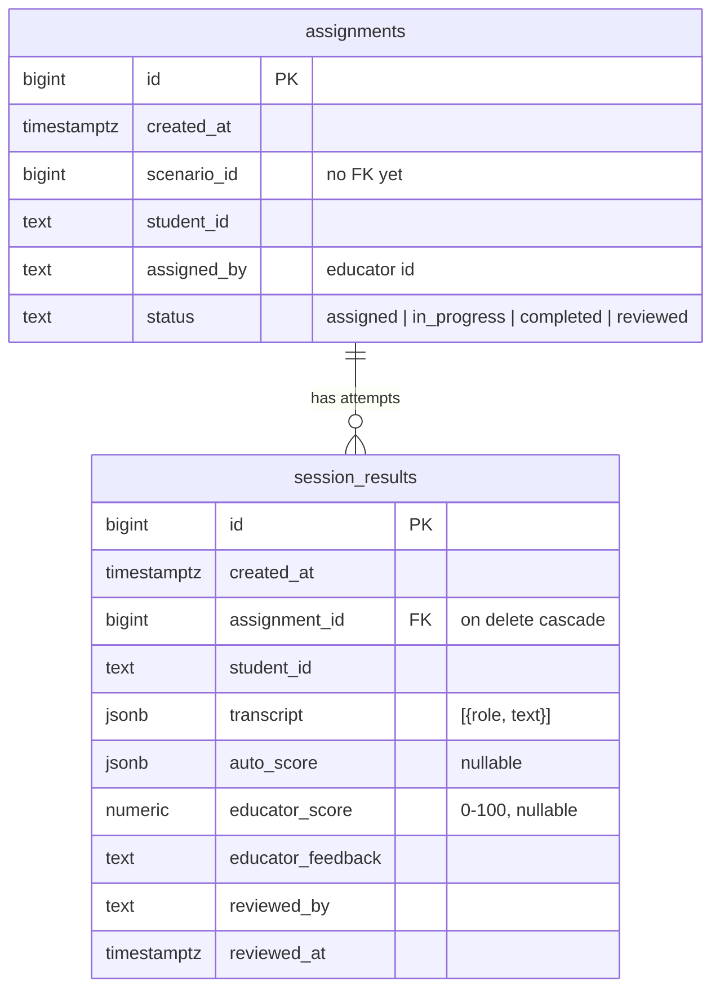
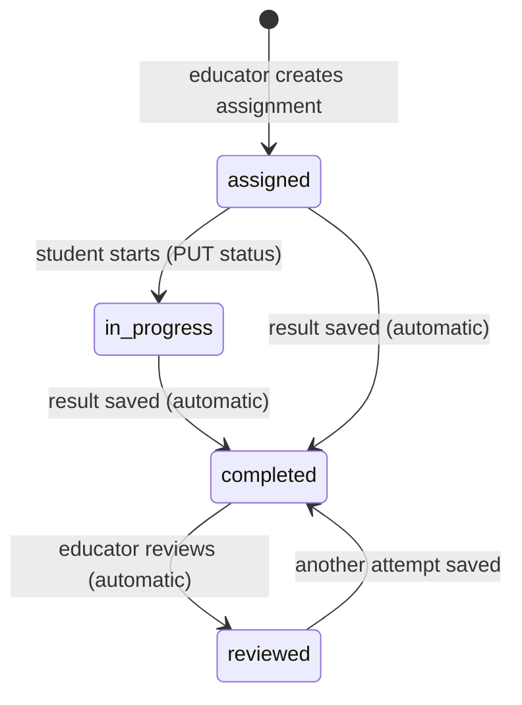
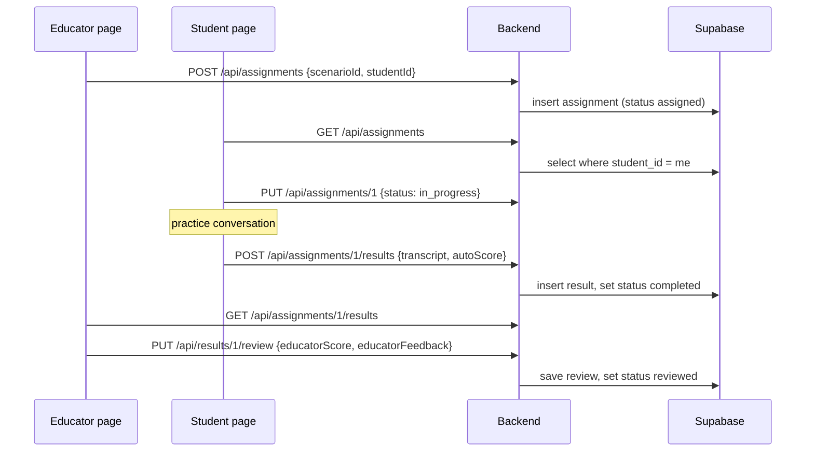
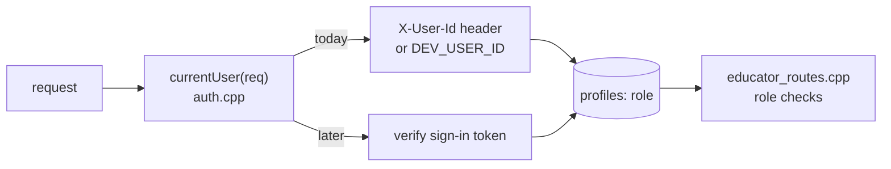

# Educator Portal API

The backend for the Educator Portal. An educator assigns a **scenario** to a **student**. The student practices it, and each practice run is saved as a **result** (the transcript plus an auto score). The educator then reviews the result and adds a grade and feedback.

- Code: `backend/src/educator_routes.cpp` (routes), `assignment*.cpp`, `session_result*.cpp`, `auth.cpp`
- Tables: `assignments`, `session_results` (SQL in `educator_tables.sql`)

---

## Tables



- User ids are stored as **text**, so whatever the user-id tables end up using (a UUID or a number) will fit.
- Deleting an assignment also deletes its results.
- One assignment can have **many results** (attempts), so repeat attempts already work.

---

## Status flow



Educators can also set any status by hand with `PUT /api/assignments/<id>`.

---

## Routes

All bodies and responses are JSON. Every error response looks like `{"error": "message"}`.

| Method | Path | Who | What it does |
|---|---|---|---|
| GET | `/api/assignments` | both | List assignments. Optional filters: `?studentId=`, `?status=`, `?scenarioId=`. Students only see their own. |
| POST | `/api/assignments` | educator | Assign a scenario: `{"scenarioId": 2, "studentId": "3"}` → 201 |
| GET | `/api/assignments/<id>` | both | Get one assignment |
| PUT | `/api/assignments/<id>` | both | Change status: `{"status": "in_progress"}`. Students may only set `in_progress`. |
| DELETE | `/api/assignments/<id>` | educator | Unassign (removes its results too) → 204 |
| GET | `/api/assignments/<id>/results` | both | Every attempt for the assignment, oldest first |
| POST | `/api/assignments/<id>/results` | both | Save an attempt (see below) → 201. Sets the status to `completed`. |
| GET | `/api/results/<id>` | both | Get one attempt |
| PUT | `/api/results/<id>/review` | educator | `{"educatorScore": 88.5, "educatorFeedback": "..."}` → 200. Sets the status to `reviewed`. |

Status codes: 400 bad input · 401 not logged in · 403 not allowed · 404 not found.

### Saving an attempt

```json
{
  "transcript": [
    { "role": "student", "text": "Hi, how are you feeling today?" },
    { "role": "patient", "text": "Not great." }
  ],
  "autoScore": { "empathy": 4 }
}
```

- `role` must be `"student"` or `"patient"`.
- `autoScore` is optional and can be any JSON object, so the scoring code can decide its own shape.
- `studentId` is taken from the assignment, never from the request body.

### Example response (one result)

```json
{
  "id": 1, "assignmentId": 1, "studentId": "3",
  "createdAt": "2026-10-26T14:29:36+00:00",
  "transcript": [ { "role": "student", "text": "..." } ],
  "autoScore": { "empathy": 4 },
  "educatorScore": 88.5,
  "educatorFeedback": "Good open questions.",
  "reviewedBy": "dev-educator",
  "reviewedAt": "2026-10-26T14:29:36Z"
}
```

---

## Typical flow



---

## Users and login (temporary)

Users are in the `profiles` table (`id bigint`, `name`, `email`, `role` = `student` | `educator` | `admin`). **Admins can do everything educators can.**

All the routes ask one function, `currentUser(req)` in `backend/src/auth.cpp`, who is calling. There's no sign-in yet, so it works like this:

1. It takes the caller's profile id from the `X-User-Id` header. If that header is missing, it uses `DEV_USER_ID` from the root `.env`.
2. It looks that id up in `profiles` and **takes the role from the table**. The request can't choose its own role.
3. If the id isn't in `profiles`, the request gets a 401.

Creating an assignment also checks that `studentId` is a profile with the role `student`. Otherwise it returns 400.

So the current frontend works with no changes: set `DEV_USER_ID` to an educator's id in `.env`. To act as a student while testing, send `X-User-Id: <a student's id>`.



**Before real users:** anyone can send someone else's id, so this is for development only. When sign-in exists, only the part of `currentUser()` that finds the id changes. It reads and verifies a token instead of the header.

---

## Decisions made without input (easy to change)

1. **Scenario CRUD lives on Parker's branch** (`/api/scenarios`). This API only stores a `scenario_id`.
2. **No foreign key to scenarios yet.** Scenarios are currently in memory, so their ids reset on restart. Once scenarios move to Supabase, add `references scenarios(id)`.
3. **User ids are stored as text** (`"3"` = `profiles.id` 3). Later they could become `bigint references profiles(id)`.
8. **Admins count as educators.**
4. **Educator grade is 0–100**, decimals allowed. Feedback is free text.
5. **Repeat attempts are allowed.** Each attempt is its own result row. The "rewind/delete a response" idea can be built on top of the transcript later.
6. **The auto score has no fixed shape.** It's any JSON object until the scoring design is settled.
7. **Students may only start their own assignments.** Saving a result marks the assignment completed, and reviewing marks it reviewed.
