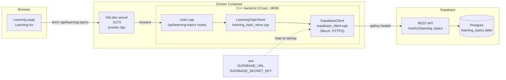
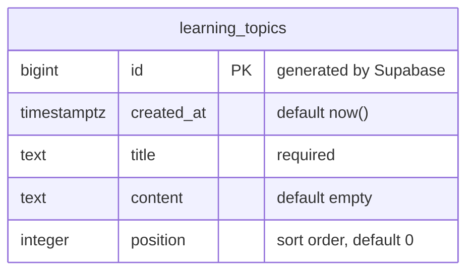
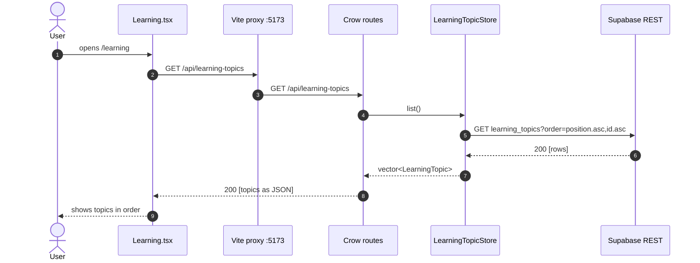
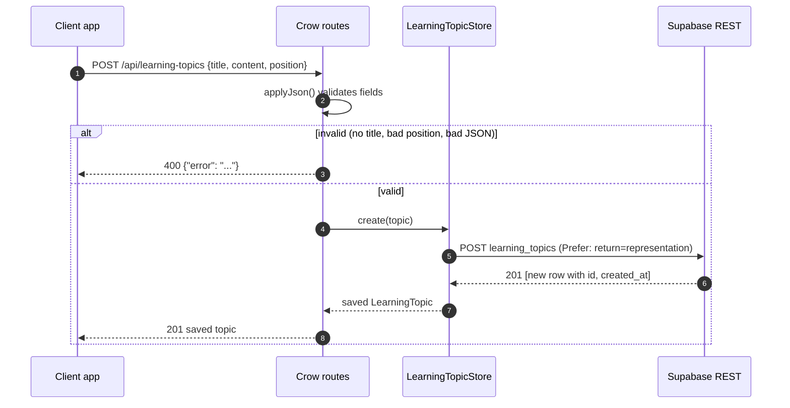
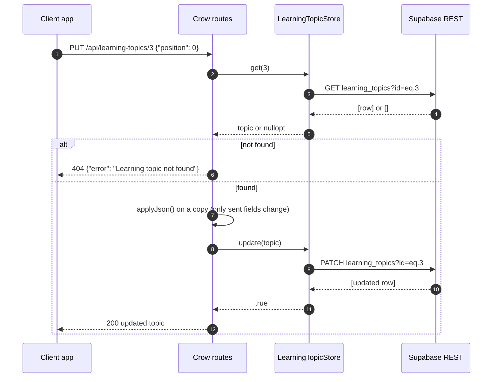
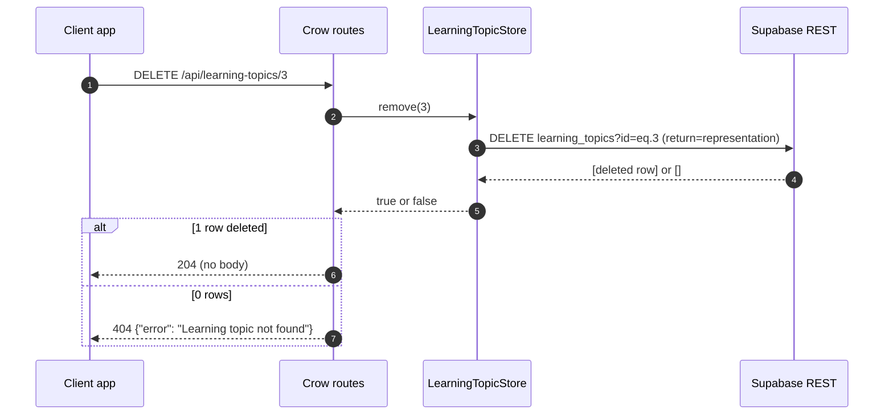
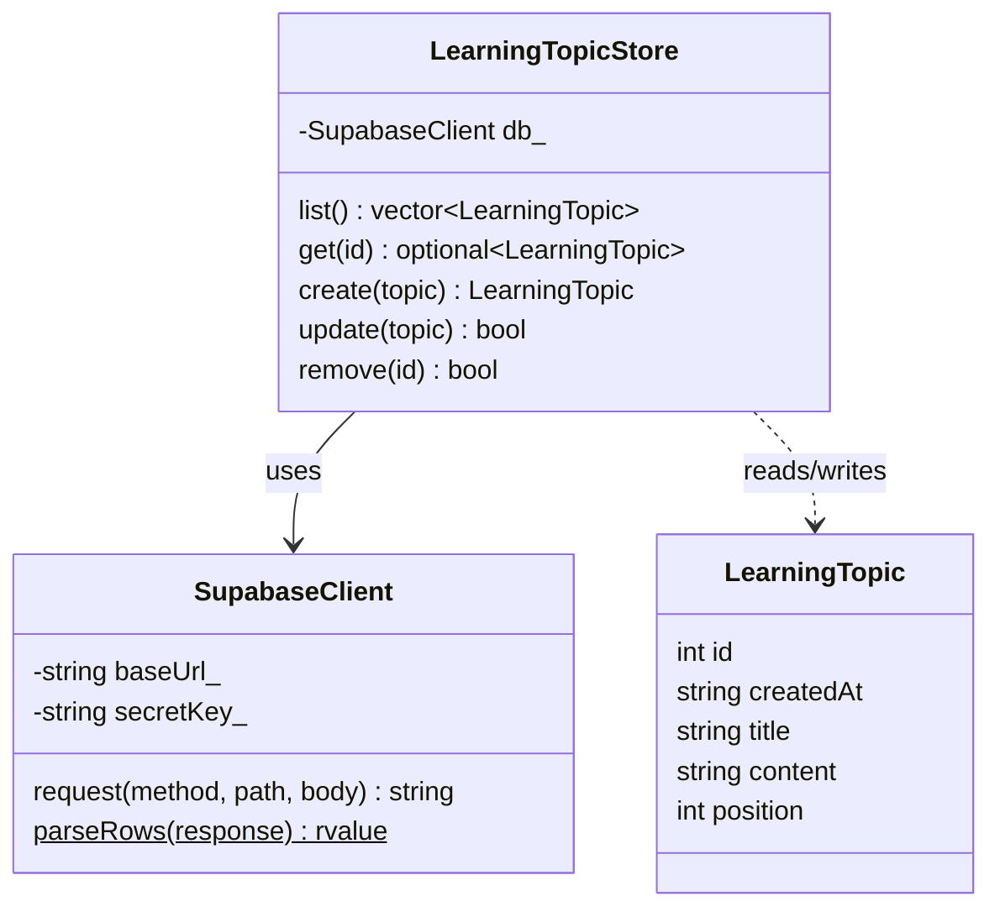

# Learning Topics API

Backend for the **Learning** page: the expandable topics ("What is Autism?",
"Communication", ...) are stored in Supabase and served by the C++ backend, so
educators can add or edit them without changing frontend code.

**Owner:** Rachel Bell · **Branch:** `learning-topics-api`

| Status | Item |
|---|---|
| ✅ Done | `learning_topics` table in Supabase, seeded with the 5 existing topics |
| ✅ Done | C++ model, store, and 5 REST routes (list, get, create, update, delete) |
| ✅ Done | Shared `SupabaseClient` helper any store can reuse |
| ✅ Done | Tested every route, including error cases |
| ⏳ Next | Learning page (`Learning.tsx`) fetches from the API instead of its hardcoded list |

---

## 1. Architecture



- The browser never talks to Supabase directly and never sees the secret key.
- The secret key lives only in the root `.env` (ignored by Git) and is passed
  into the backend container by `compose.yaml`.

---

## 2. Database table



Created with:

```sql
create table public.learning_topics (
  id         bigint generated always as identity primary key,
  created_at timestamptz not null default now(),
  title      text not null,
  content    text not null default '',
  position   integer not null default 0
);

alter table public.learning_topics enable row level security;
```

Row level security is on with no policies, so the table can't be read or
written from a browser. The backend uses the secret key, which bypasses RLS.

---

## 3. JSON shape

What the API sends and accepts:

```json
{
  "id": 1,
  "createdAt": "2026-10-20",
  "title": "What is Autism?",
  "content": "Learn about autism spectrum disorder, ...",
  "position": 1
}
```

| Field | Type | Set by | Rules |
|---|---|---|---|
| `id` | integer | Supabase | ignored if sent |
| `createdAt` | string `YYYY-MM-DD` | Supabase | ignored if sent |
| `title` | string | client | **required**, can't be empty |
| `content` | string | client | optional, defaults to `""` |
| `position` | whole number | client | optional, defaults to `0`; lower appears first |

---

## 4. API

| Method | Route | Body | Success | Errors |
|---|---|---|---|---|
| GET | `/api/learning-topics` | none | `200` array, sorted by `position` then `id` | |
| GET | `/api/learning-topics/{id}` | none | `200` topic | `404` |
| POST | `/api/learning-topics` | topic fields | `201` saved topic with `id` | `400` |
| PUT | `/api/learning-topics/{id}` | only the fields to change | `200` updated topic | `400`, `404` |
| DELETE | `/api/learning-topics/{id}` | none | `204` no body | `404` |

All errors return `{"error": "message"}`. If Supabase can't be reached, the
route returns `500` and the backend logs the cause.

Example:

```bash
curl -X POST http://localhost:5173/api/learning-topics \
  -H "Content-Type: application/json" \
  -d '{"title": "Routines and Transitions", "content": "...", "position": 6}'
```

---

## 5. Request flows

### Loading the Learning page



### Creating a topic



### Updating a topic (partial update)



### Deleting a topic



---

## 6. Code structure



| File | Purpose |
|---|---|
| `backend/src/learning_topic.h/.cpp` | `LearningTopic` struct, `toJson()`, `applyJson()` (validation) |
| `backend/src/learning_topic_store.h/.cpp` | One Supabase request per method |
| `backend/src/supabase_client.h/.cpp` | Shared HTTPS helper, reusable by other stores |
| `backend/src/main.cpp` | The 5 `/api/learning-topics` routes |
| `backend/CMakeLists.txt` | Adds the 3 new `.cpp` files to the build |

---

## 7. Testing

With Docker running (`docker compose up`):

| Test | Expected |
|---|---|
| `GET /api/learning-topics` | the 5 seeded topics, in order |
| `POST` with title, content, position | `201` with a new `id` |
| `PUT /{id}` with `{"position": 0}` | `200`; that topic moves to the top of the list |
| `POST` without a title | `400 'title' is required` |
| `POST` with `"position": 1.5` | `400 'position' must be a whole number` |
| `PUT /{id}` with `{"title": ""}` | `400 'title' is required` |
| `GET`, `PUT`, or `DELETE` a missing id | `404` |
| `DELETE /{id}` | `204`; a second delete returns `404` |

The database connection can also be confirmed by editing a title in
Supabase's Table Editor and reloading `GET /api/learning-topics`.

---

## 8. Next steps

- [ ] **Frontend:** `Learning.tsx` fetches `/api/learning-topics` on load instead of the hardcoded `learningTopics` array
- [ ] **Shared helper:** `persona_store` could switch to `SupabaseClient` instead of its own request code, and `scenario_store` can use it when scenarios move to Supabase
- [ ] **Educator editing:** a UI for educators to add, edit, and reorder topics using the POST/PUT/DELETE routes
