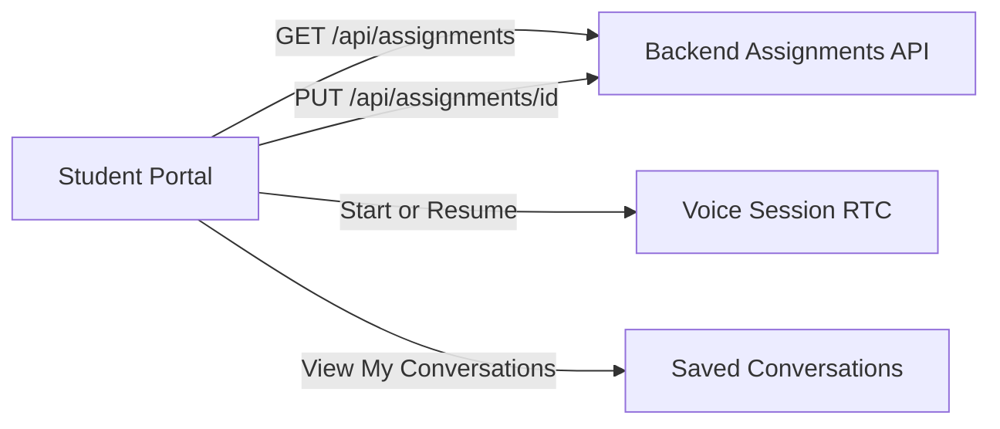

# Student Portal (`StudentPortal.tsx`)


The student-facing dashboard for VERA. It fetches the logged-in student's assigned scenarios from the backend, filters out archived items, displays assignment progress, and routes students into live AI patient voice sessions (`/rtc`) or their branching conversation history (`/conversations`).


- **Files:** `frontend/src/pages/StudentPortal.tsx` (UI), `frontend/src/api/assignments.ts` (API client)

- **Related Docs:** [conversation-tree.md](conversation-tree.md), [educator-portal.md](educator-portal.md)


---


## 1. Architecture & Navigation Flow





---


## 2. Assignment Lifecycle & Actions


Each assignment card renders action buttons dynamically based on its current `status`:


| Assignment Status | Badge Label | Primary Action Button | Route / API Behavior | Secondary Action |

|---|---|---|---|---|

| `assigned` | **Assigned** | **Start Scenario** | Calls `startAssignment(id)` (`PUT /api/assignments/:id` → `in_progress`), then navigates to `/rtc?assignmentId=<id>` | *None* |

| `in_progress` | **In progress** | **Continue Conversation** | Navigates to `/rtc?assignmentId=<id>&resume=1` (automatically picks up the newest `in_progress` attempt) | **View My Conversations** → `/conversations?assignmentId=<id>` |

| `completed` | **Completed** | **Practice Again** | Navigates to `/rtc?assignmentId=<id>` (starts a new attempt while preserving prior attempts) | **View My Conversations** → `/conversations?assignmentId=<id>` |

| `reviewed` | **Reviewed** | **Practice Again** | Navigates to `/rtc?assignmentId=<id>` (starts a new attempt without overwriting educator feedback) | **View My Conversations** → `/conversations?assignmentId=<id>` |


---


## 3. Data Shape (`Assignment`)


Fetched via `listAssignments()` (`GET /api/assignments`), which automatically scopes results to the currently authenticated student:


```typescript

export interface Assignment {

  id: number;

  createdAt: string;

  scenarioId: number;

  studentId: string;

  assignedBy: string;

  status: 'assigned' | 'in_progress' | 'completed' | 'reviewed';

  archived?: boolean;

}

```


- **Archived Filtering:** Assignments with `archived: true` are hidden from the student view (`!a.archived`).

- **Client-Side Search:** Filters visible cards in real time against `scenario <scenarioId> <status>`.


---


## 4. Integration with Voice Sessions & Conversation Trees


1. **Starting & Resuming (`/rtc`):**

   - **First launch (`Start Scenario`):** Marks the assignment `in_progress` in Supabase before opening `/rtc?assignmentId=<id>` so educators immediately see the student has begun.

   - **Resuming (`Continue Conversation`):** Passes `&resume=1` so `RTC.tsx` queries `listConversations(assignmentId)` and resumes from the saved bookmark of the latest `in_progress` conversation.

   - **Re-practicing (`Practice Again`):** Opens `/rtc?assignmentId=<id>` without a `conversationId`, creating a fresh attempt (`conversation` row) while keeping earlier attempts intact.

2. **Reviewing Past Attempts (`/conversations`):**

   - Clicking **View My Conversations** opens `/conversations?assignmentId=<id>`, where students can inspect their branching `ConversationTreeView`, read linear turn transcripts, or click **↩ Continue from this line** to branch off from an earlier turn.

3. **In-Session Tree View & Educator Grading:**

   - Inside `RTC.tsx`, students can toggle **Show Conversation Tree** to inspect or rewind turns mid-session without cluttering the screen.

   - In the Educator Portal (`AttemptsPanel.tsx`), instructors view the read-only `ConversationTreeView` directly above the **Score (0–100)** and **Feedback** form.


---


## 5. Future Handoff Notes


- **Scenario Titles & Descriptions:** Currently, assignment cards display `Scenario #<scenarioId>` because `Assignment` only stores `scenarioId`. Once `/api/scenarios` is wired into `StudentPortal.tsx`, fetch scenarios on load to display the scenario's human-readable title, description, and estimated completion time.

- **Educator Feedback Display:** `AttemptsPanel.tsx` saves `educatorScore` and `educatorFeedback` on `session_results`. Surfacing a read-only grade/feedback summary on `reviewed` cards (or inside `/conversations`) will let students see instructor notes directly from their portal.
